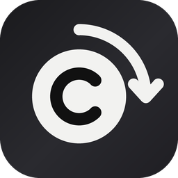
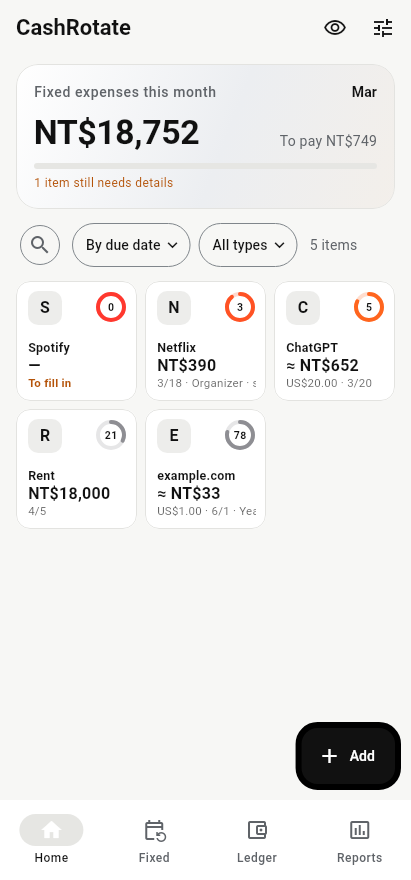
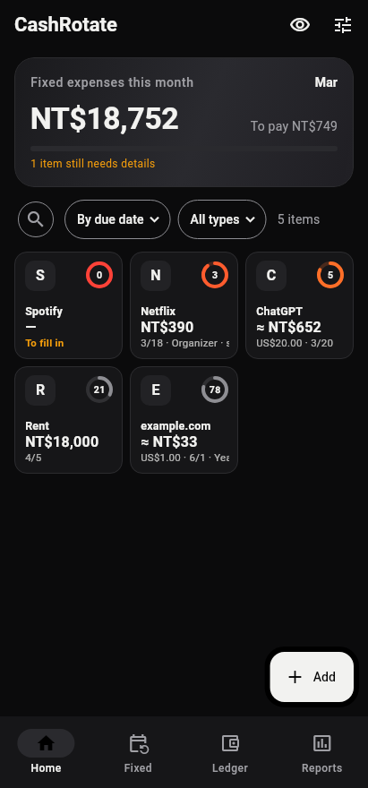
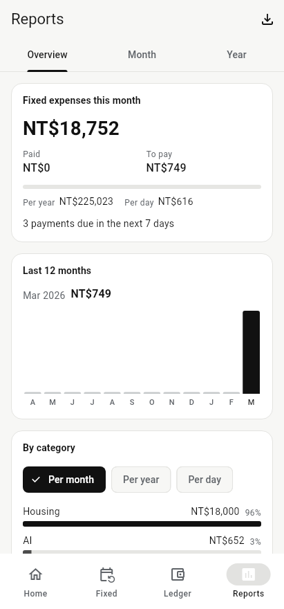
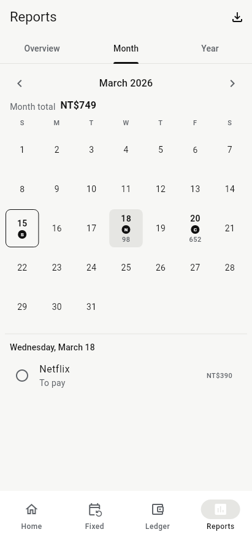

# CashRotate

**以「每月固定支出」為主角的記帳 App。** 訂閱、帳單、分期、保險年費一目了然；讀取銀行通知自動記下每期實付金額。資料只存在你的手機和你自己的 WebDAV，上傳前端對端加密。沒有開發者伺服器，也不用註冊帳號。

> ⚠️ **預覽版（v0.7.1）**：功能大致齊全，但還在測試中，資料格式可能變動，請不要拿來當唯一的財務紀錄。目前只有 Android。App 名稱為暫定。

[下載最新預覽版 APK](../../releases) · [English](#english)

<p>
  
  
  
  
</p>

## 特色

- **固定支出優先**：
  - **五種類型**：訂閱、帳單、還款（分期）、保險與年費、定期轉出。
  - **價格與週期**：支援首期優惠、試用、漲價，以及不固定週期的儲值。
  - **首頁**：方塊依扣款日排序，倒數環顯示還剩幾天。
- **自動辨識扣款**：
  - **通知辨識**：只讀你勾選的銀行和支付 App 的通知，全部在手機上比對；高信心的自動記為已付，可以撤銷。
  - **不在清單裡的扣款**：發現週期性扣款時，會建議加成固定支出。
- **付款紀錄**：
  - **記下實付金額**：外幣項目會反推實際匯率，並學習每張卡的加價。
  - **不同於預期時**：可選「只這一次」或「更新之後的價格」。
- **提醒**：
  - **提醒種類**：續訂前、試用轉付費、合約到期、域名寬限期、浮動帳單確認金額。
  - **通知操作**：可直接按「已付款」「延後」「前往取消」，手錶上也能按。
- **合租**：
  - **角色**：可當主揪者或成員。
  - **分攤**：均分、自訂或輪流付款，支援混合幣別。
  - **金額計算**：月成本只算你的份額，另外列出「別人欠我 / 我欠別人」。
- **多幣別**：支援 41 種幣別（亞太全部，加上 USD、EUR），每日自動更新匯率，也可手動指定。
- **分析**：本月已付 / 待付、近 12 月、分類排行、漲價歷史、月曆與年曆、年 / 日成本換算，付款紀錄可匯出 CSV。
- **資料自主**：
  - **儲存**：本機資料庫用 SQLCipher 加密。
  - **同步**：WebDAV 同步用 XChaCha20-Poly1305 加密，金鑰由 Argon2id 衍生，並附復原碼。
  - **保護**：App 鎖（PIN 加指紋 / 臉部）、隱藏金額模式。
  - **備份**：每日自動備份，也可手動匯出加密備份。
- **其他**：
  - **介面與語言**：繁中 / 簡中 / 英文，深色模式，手機、摺疊機和平板自適應。
  - **捷徑**：桌面小工具（小 / 中 / 大）、App 捷徑。

## 隱私

App 只會連到三種地方：

1. **你的 WebDAV**：只會收到密文。
2. **公開資料**：匯率（open.er-api.com，備援 fawazahmed0 currency-api）和預設庫更新。
3. **沒有別的**：不收集分析資料，當機回報預設關閉。

讀取通知的權限只用於你勾選的 App，通知內容不會離開手機。

## 安裝

到 [Releases](../../releases) 下載 `cashrotate-*.apk`，在 Android 8.0 以上安裝。預覽版用 debug 金鑰簽署，所以之後換成正式版時需要先解除安裝；移除前請先用 App 內的「備份」匯出資料。

## 從原始碼建置

需要 Flutter 3.47.8（穩定版）和 JDK 21。

```bash
flutter pub get
cd app && flutter build apk --release
```

在 Windows 上建置還需要 Git Bash 和 `make`，詳見 [ADR 0013](docs/adr/0013-m5-sync-and-security.md)。

各套件的測試指令：

```bash
cd app && flutter test
cd packages/core && dart test
cd packages/sync && dart test
```

### 專案結構

| 路徑 | 內容 |
| --- | --- |
| `app/` | Flutter App；原生 Kotlin 程式在 `app/android`（提醒、通知讀取、小工具、Keystore）。 |
| `packages/core/` | 純 Dart 領域邏輯：週期與價格階段引擎、提醒排程、扣款辨識、合租、匯率。 |
| `packages/sync/` | 加密同步引擎：混合邏輯時鐘、欄位級合併、WebDAV。 |
| `presets/` | 服務預設庫（多語名稱、分類、取消連結；不含價格與商標圖）。 |
| `docs/adr/` | 架構決策紀錄。 |

## 進度

v0.7.1 完成了里程碑 M0–M5 和 M7。接下來是打磨與上架（M8）。AI 匯入和 Wear OS 資訊卡移到了 [backlog](docs/backlog.md)。

歡迎用 Issues 回報問題，或提供銀行與支付 App 的通知樣本（請先遮掉卡號和金額），用來改進自動辨識。

## 授權

[GNU AGPL-3.0](LICENSE)。預設庫裡的服務名稱和品牌屬於各自的權利人，本 App 不內建任何商標圖示。

---

## English

**CashRotate** is a privacy-first tracker for your recurring expenses: subscriptions, bills, instalments, insurance and annual fees.

- **How it works**: it reads the bank and payment-app notifications you choose, on the device only, and records what you actually paid each period.
- **Where your data lives**: your data stays on your phone and, if you wish, in your own WebDAV folder, end-to-end encrypted (XChaCha20-Poly1305, Argon2id). There is no developer server and no account.
- **Features**:
  - Price phases: intro prices, trials and price rises.
  - Shared plans, where you can be the organiser or a member.
  - 41 currencies with daily exchange rates.
  - Reminders with Paid, Later and Go cancel actions, also on a paired watch.
  - Reports with month and year calendars, plus CSV export.
  - App lock, home-screen widgets.
  - Traditional Chinese, Simplified Chinese and English.

> **Preview (v0.7.1)**: still being tested and the data format may change. Android only, and the name is provisional.

Download the APK from [Releases](../../releases), or build it with Flutter 3.47.8 as shown above. Licensed under [AGPL-3.0](LICENSE).
